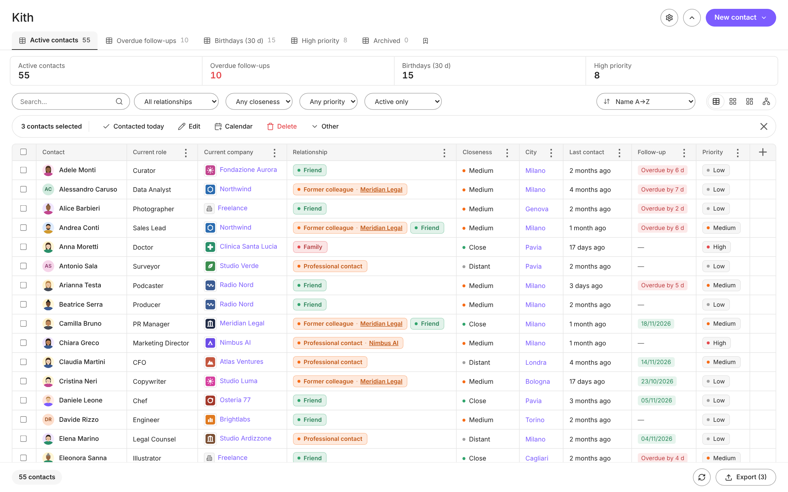
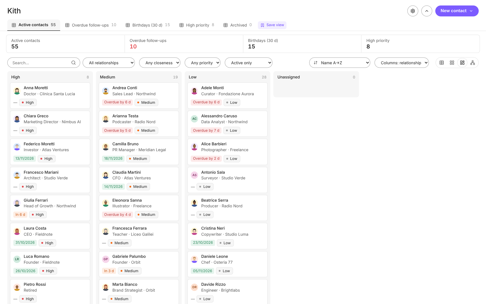
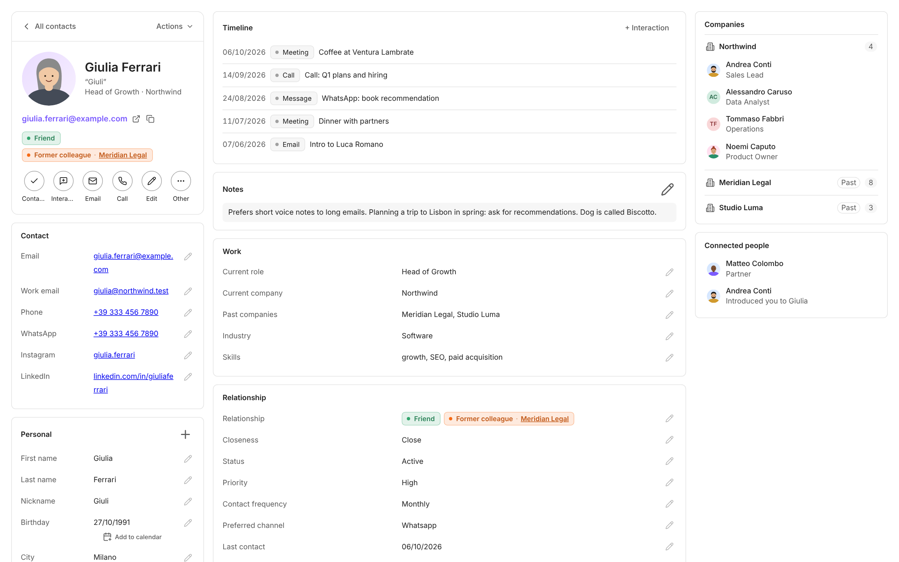
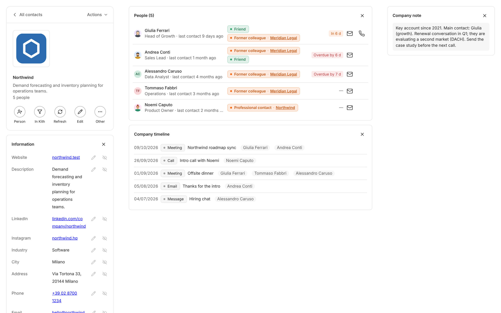
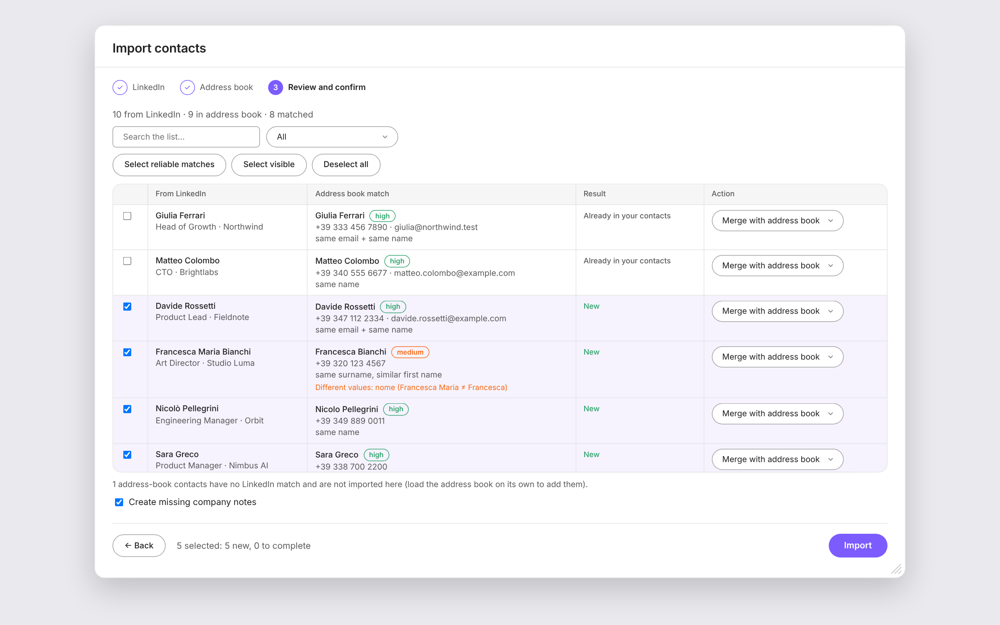

# Kith · a personal CRM for Obsidian

> *Kith: the people you know and care about.* A modern personal CRM built **on top of your own notes**. One note per person, plain Markdown + frontmatter, no database, no cloud, no account.
> UI in **English and Italian** (follows Obsidian's language).
>
> Built on the [**file over app**](https://stephango.com/file-over-app) philosophy (Steph Ango, [@kepano](https://x.com/kepano)): your contacts are plain files you own and can read in any editor, today and in thirty years. Kith is just a lens on them; if you remove the plugin, nothing is lost.

Table, cards, kanban and relationship-graph views · full-page contact records and **company pages** · customizable columns · multi-tag relationships linked to companies · bulk importer (LinkedIn, phone, Facebook, CSV) · follow-up reminders · birthdays → Google Calendar / `.ics` · "Today" widget for your daily note · fully customizable fields, colors and fonts. It follows your theme (designed with the *Minimal* theme in mind) and takes its visual cues from modern CRM tools: flat, dense, quiet.

<p align="center"></p>

*Demo set of 55 fictional contacts. More screenshots in the [Gallery](#gallery).*

🇮🇹 [Vai alla sezione in italiano](#-italiano)

---

## Contents
- [Gallery](#gallery)
- [Features](#features)
- [Installation](#installation)
- [Quick start](#quick-start)
- [How contacts are stored](#how-contacts-are-stored)
- [Views](#views)
- [Importing contacts](#importing-contacts)
- [Follow-ups, interactions, birthdays](#follow-ups-interactions-birthdays)
- [Google Calendar and .ics export](#google-calendar-and-ics-export)
- ["Today" widget](#today-widget)
- [Customization](#customization)
- [Language and date formats](#language-and-date-formats)
- [Commands](#commands)
- [Settings reference](#settings-reference)
- [Privacy](#privacy)
- [Development](#development)
- [Limitations and roadmap](#limitations-and-roadmap)
- [🇮🇹 Italiano](#-italiano)
- [License](#license)

---

## Gallery

Demo set: people, companies, addresses and numbers are **fictional**; photos and logos are generated illustrations (no real brands). Click an image to see it full size.

<table>
<tr><th width="33%">Table</th><th width="33%">Kanban</th><th width="33%">Contact record</th></tr>
<tr><td align="center" width="33%"><a href="docs/gallery-home.png"></a></td><td align="center" width="33%"><a href="docs/gallery-kanban.png"></a></td><td align="center" width="33%"><a href="docs/gallery-contact.png"></a></td></tr>
<tr><th width="33%">Company page</th><th width="33%">Importer</th><th width="33%"></th></tr>
<tr><td align="center" width="33%"><a href="docs/gallery-company.png"></a></td><td align="center" width="33%"><a href="docs/gallery-import.png"></a></td><td></td></tr>
</table>

---

## Features

| Area | What you get |
|---|---|
| **Views** | Table (fully configurable columns), cards, kanban (group by relationship / closeness / status / priority, drag & drop), relationship **graph** |
| **Contact record** | Full-page record (click a name): inline editing, custom photo, connected people, companies (current and past), recent interactions, clickable email / phone / WhatsApp / LinkedIn / Instagram |
| **Company pages** | One page per company collecting its people, info, notes and timeline; auto-filled from the web, per-company sections and fields, manual logo |
| **Relationships** | Several tags per person, each optionally tied to a company (`former colleague @ Google`), with colors |
| **Bulk actions** | Select rows → action bar above the table: contacted today, edit, add relationship, archive, delete, calendar |
| **Filters & KPIs** | Search, filter by relationship / closeness / priority / status, clickable KPI strip (active contacts, overdue follow-ups, upcoming birthdays, high priority) |
| **Importer** | One importer with automatic detection: LinkedIn `Connections.csv`, phone `.vcf` / Google Contacts CSV, Facebook friends (`.json` / `.html`), generic CSV. Load LinkedIn and your address book together to **cross-check** them (email, profile, name). **You pick who gets imported**; duplicates are detected and nothing is written before you confirm |
| **Follow-ups** | "Next follow-up" date or "contact frequency" → automatic due dates, overdue / due-soon badges, "Contacted today" in one click |
| **Interactions** | Log calls, meetings, messages as notes linked to the person; the last-contact date updates automatically |
| **Birthdays** | Upcoming-birthday agenda, one-click **Add to Google Calendar** (pre-filled yearly all-day event), `.ics` export |
| **Daily note widget** | A `crm-oggi` code block listing overdue follow-ups, the next days and birthdays |
| **Customization** | Dialog for colors, fonts, density, corner radius, **custom / hidden / renamed fields**, table columns |
| **Safe delete** | Delete with confirmation (system trash, vault `.trash`, or permanent — follows *your* Obsidian setting), or archive instead |
| **Bilingual** | English / Italian UI **and** English / Italian frontmatter keys, both always recognized |

## Installation

### Manual
1. Download `main.js`, `manifest.json` and `styles.css` from this repository (or from a release).
2. Put them in `<your-vault>/.obsidian/plugins/kith/`.
3. In Obsidian: **Settings → Community plugins →** turn off *Restricted mode* → enable **Kith**.

### With BRAT
Add `Gusions/obsidian-kith` in the [BRAT](https://github.com/TfTHacker/obsidian42-brat) plugin (needs a GitHub release containing the three files).

Requires Obsidian **1.5.0+**. Developed and tested on desktop; mobile is not flagged as unsupported but has not been tested.

## Quick start

1. Open **Settings → Kith** and set the three folders (by default `Contacts/People`, `Contacts/Interactions`, `Contacts/Companies` in English; `Persone/Persone`, `Persone/Interazioni`, `Persone/Aziende` in Italian). If you already have contact notes, point *Contacts folder* to them.
2. Click the **users** icon in the left ribbon (or run *Open Kith*).
3. Either **+ New contact**, or import your LinkedIn / phone / Facebook export from **New contact ▾ → Import contacts** (or the *Import contacts* command).
4. Tick a row to get the action bar (**Contacted today**, **Interaction**, **Edit**, **Calendar**, **Delete**…), or click a name to open the full record.

## How contacts are stored

Following *file over app*, each contact is a normal note in the contacts folder: no database, no proprietary format, nothing to export or migrate. Kith only reads and edits these files, so they stay yours and keep working with or without the plugin. Properties live in the frontmatter, so you can also edit them in Obsidian's Properties panel, query them with Bases / Dataview, or sync them however you already sync your vault.

```yaml
---
first_name: Jane
last_name: Doe
birthday: 2026-03-14
city: Boston
email: jane@example.com
current_company: "[[ACME]]"
relationship: former colleague
closeness: close
priority: high
contact_frequency: quarterly
last_contact: 2026-06-10
next_follow_up: 2026-09-15
interests: [running, wine]
---
```

**Key names are forgiving.** Matching ignores case, accents, spaces, `_` and `-`, and both languages are accepted: `first_name`, `First name` and `nome` are all the same field. Existing notes are never rewritten; when you edit a contact the plugin reuses the key already present in that note, and only new properties use the default key of the current language.

**Dates are always written as ISO** (`2026-03-14`, birthday without year: `--03-14`) because it is the only unambiguous format. How dates are *shown* is configurable.

<details>
<summary><strong>Field reference</strong> (English default key / Italian default key)</summary>

| Section | Field | EN key | IT key |
|---|---|---|---|
| Personal | First name | `first_name` | `nome` |
| | Last name | `last_name` | `cognome` |
| | Nickname | `nickname` | `soprannome` |
| | Birthday | `birthday` | `compleanno` |
| | City / Country | `city` / `country` | `citta` / `paese` |
| | Photo | `photo` | `foto` |
| | Partner / Children / Languages | `partner` / `children` / `languages` | `partner` / `figli` / `lingue` |
| Contact | Email / Work email | `email` / `work_email` | `email` / `email_lavoro` |
| | Phone / WhatsApp | `phone` / `whatsapp` | `telefono` / `whatsapp` |
| | Instagram / LinkedIn | `instagram` / `linkedin` | `instagram` / `linkedin` |
| Work | Current role | `current_role` | `ruolo_attuale` |
| | Current company (`[[link]]`) | `current_company` | `azienda_attuale` |
| | Past companies | `past_companies` | `aziende_passate` |
| | Industry / Skills | `industry` / `skills` | `settore` / `competenze` |
| Relationship | Relationship (list; `label @ Company` links a tag to a company) | `relationship` | `relazione` |
| | Closeness | `closeness` | `vicinanza` |
| | Status | `status` | `stato` |
| | Priority | `priority` | `priorita` |
| | Contact frequency | `contact_frequency` | `frequenza_contatto` |
| | Preferred channel | `preferred_channel` | `canale_preferito` |
| | Last contact | `last_contact` | `ultimo_contatto` |
| | Next follow-up | `next_follow_up` | `prossimo_follow_up` |
| | When to reach out | `when_to_contact` | `quando_contattare` |
| | Met where / when / through | `met_where` / `met_when` / `met_through` | `conosciuti_dove` / `_quando` / `_tramite` |
| Network | Interests | `interests` | `interessi` |
| | Can help me with / I can help with | `can_help_me_with` / `i_can_help_with` | `puo_aiutarmi_con` / `posso_aiutarlo_con` |
| | Favors received / given | `favors_received` / `favors_given` | `favori_ricevuti` / `favori_dati` |
| Notes | Notes | `notes` | `note` |

List fields (interests, skills, languages, children, past companies) accept YAML lists or a comma-separated line (`a, b, c`; the older `a | b | c` is still understood). Kith shows and edits them comma-separated.
</details>

### Values the plugin understands

Free text is fine, but these values drive logic and colors, in English or Italian:

| Field | Values |
|---|---|
| Priority | `high` / `medium` / `low` · `alta` / `media` / `bassa` |
| Closeness | `close` / `medium` / `distant` · `stretta` / `media` / `lontana` |
| Contact frequency | `weekly` `monthly` `quarterly` `semiannual` `yearly` · `settimanale` `mensile` `trimestrale` `semestrale` `annuale` |
| Status | `active` / `dormant` / `archived` · `attivo` / `dormiente` / `archiviato` |

An **archived** contact disappears from the default views and KPIs ("Active only" filter).

Interaction notes (created by *+ Interaction*) live in the interactions folder and carry `person: [[Jane Doe]]`, `type`, `date` (Italian: `persona`, `tipo`, `data`). Any note in that folder that links to a contact counts as an interaction with them.

## Views

- **Table**: use the **⋮** menu in each column header to sort, filter, pin, move or remove it, and **+** at the end to add any field (custom ones included). Company, email and city cells are clickable (a city lists everyone who lives there), and a small company icon sits next to the company name. The header can be collapsed (default).
- **Bulk action bar**: tick one or more rows and an action bar appears above the table: *Contacted today*, *Interaction*, *Edit* (or add a relationship / closeness / priority / status to many at once), *Calendar*, *Delete* (with confirmation), *Open record*, *Archive*.
- **Cards**: compact cards with tags, next birthday and due state.
- **Kanban**: group by relationship, closeness, status or priority; **drag a card to another column** to change that value.
- **Graph**: contacts as nodes. Connections come from a shared company (2+ people): current, past, or named in a relationship tag such as *former colleague @ Company*, *Met through* naming another contact, *Partner*, or `[[links]]` between notes. Shows the 700 most connected contacts; toggle companies and isolated contacts. The detail panel on the right is only shown in this view; **double-click a node** (or use *Open full record*, or click the name or photo in the panel) to open the full page.
- **Saved views**: save the current filters, quick filter, search, sort, mode and column filters as a tab next to the built-in ones; update, rename or delete from the tab's menu. The `+` turns highlighted when the current state differs from every saved view.
- **Side panel**: a compact list of contacts in the left sidebar (search, filters, quick access). It opens with Kith and closes when you leave it; it stays collapsed until you open it.
- **Home**: a **New contact ▾** pill (new contact, import), pill search and filters, a footer with the contact count and **Export CSV** (only the selected contacts; *Select all* in the table header selects the current filter).
- **Resizable dialogs**: drag the corner handle of Customize or Import; double-click it to reset.
- **Menus**: every Kith menu (context menus, column headers, bulk actions, the *Other* button) uses the same popover: icons, sections, search when long, drill-in submenus, keyboard navigation.
- **Contact record** (click a name): full page with resizable columns, inline editing, a custom photo (upload, paste from the clipboard, paste a link, or try to fetch it from the contact's Instagram handle), connected people with the reason (partner, "introduced you to X" / "introduced by X"), and a **Companies** card listing current, past and relationship companies; each company links to everyone connected with it, past ones are collapsed by default.
- **Company page**: click any company (same header as the contact page, with an *Actions* menu and *Edit*). It lists its people and shows info, notes and a timeline. Kith can fill the empty fields (website, industry, contacts, logo) from Wikidata and the official website; you can also upload a logo, paste a link or fetch it from the company's Instagram. Hide or show sections and fields **per company**, with an optional "use for all", and drag the column dividers to resize.
- **Navigation**: the back button (or a swipe back) walks back through record, company and table.
- **Right-click menus**: *Copy name / email / phone / full record*, *Archive*, *Delete…*. Keyboard: `Delete` / `⌘⌫` on a selected contact starts the delete flow (with confirmation).

## Importing contacts

Open **New contact ▾ → Import contacts** (or **Customize → Import**, or run the command *Import contacts*). Drop one or more files: Kith detects the source of each one. Check the preview, choose who to import, and confirm. Nothing is created before that.

**LinkedIn + address book:** drop both files together and Kith cross-checks them by email, LinkedIn profile and name. You see each LinkedIn contact next to its address-book match, with homonyms and already-present contacts flagged, and choose whether to add, complete or skip. LinkedIn provides role, company and profile; the address book provides phone and personal data. Address-book contacts with no LinkedIn match can be imported by loading the address book on its own.

| Source | How to export |
|---|---|
| **LinkedIn** | Settings → Data privacy → *Get a copy of your data* → select *Connections* → download the zip → use `Connections.csv` |
| **iPhone** | iCloud.com → Contacts → select all → *Export vCard* |
| **Android / Google** | contacts.google.com → Export → vCard (`.vcf`) or Google CSV |
| **Facebook** | Settings → Your information → *Download your information* → Friends and followers, JSON → `your_friends.json` (Facebook only exports name and friendship date) |
| **Generic CSV** | Any CSV with headers like *First name, Last name, Email, Phone, Company…* in English or Italian; `,` or `;` separator |

The preview marks each row as **New**, **Already present** (same email / phone / LinkedIn / name) or **Duplicate in file**. For existing contacts choose *Skip* or *Fill empty fields only* (never overwrites what you wrote). Optionally create missing company notes and set a relationship for all new contacts. Large lists are paged; you can stop mid-import.

## Follow-ups, interactions, birthdays

- **Due date** = *Next follow-up* if set; otherwise *Last contact* + *Contact frequency*.
- States: **overdue**, **due within 7 days**, **ok**. They feed the KPI strip, the agenda panel, badges, and the widget.
- **Contacted today** sets *Last contact* to today and clears an expired follow-up.
- **+ Interaction** creates a note like `2026-06-10 Call - Jane Doe`, links it to the contact, updates *Last contact*, and optionally sets the next follow-up.

## Google Calendar and .ics export

No account linking, no OAuth, no API keys. For a birthday the plugin opens Google Calendar with a **pre-filled yearly all-day event**; you press *Save* (and choose reminders and the target calendar there). The contact then gets `birthday_in_calendar: <date>` so the CRM knows it's done.

- Offered automatically after you save a contact with a birthday (can be turned off), via the **Calendar** button (table toolbar, bulk action bar, contact record, or next to the birthday date), or the command *Add the contact's birthday to Google Calendar*.
- Title and description templates are editable (placeholders `{first} {last} {age}`; the Italian `{nome} {cognome} {eta}` also work).
- **Add to calendar** (header button) and the **Calendar** menu export all birthdays (yearly recurrence), or just the selected contacts, and optionally follow-up due dates, to a `.ics` file you can import into Apple Calendar, Outlook, Google Calendar…

## "Today" widget

Insert (command *Insert CRM "Today" widget in note*) a code block in any note, typically your daily note:

````markdown
```crm-oggi
giorni: 7
max: 6
titolo: CRM · Today
```
````

Options: `giorni` (look-ahead window in days, default 7), `max` (rows per section, default 6), `titolo` (title). It lists contacts to follow up, the next days, and upcoming birthdays, with a one-click *contacted* check. Optionally the plugin can add the block to newly created daily notes (experimental, off by default).

## Customization

**Settings → Kith → Customize**, or the *Customize* button in the Kith header.

- **Appearance**: font (theme / system sans / serif / mono / any installed font), text scale, row density, corner radius, column borders, KPI strip.
- **Colors**: by default **everything follows your active theme**. Override accent, danger, warning, ok and birthday colors for the CRM only; avatars colored or neutral; neutral or per-value colored tags; color per relationship.
- **Fields**: rename any field, hide it from the form and the record, or add **custom fields** (text, long text, list, choice, in any form section). Data in your notes is never deleted when you hide or remove a field.
- **Table**: choose and order the columns, including custom fields.
- **Google Calendar**: enable, auto-offer, title and description templates.
- **Modern mode** (*Settings → Kith → Customize → General → Modern mode*): an alternative look for every Kith page: minimal tabs, number cards, pill filters, a table without grid lines, a floating selection bar, softer cards on contact and company pages. Off by default; turning it off restores the classic look.

## Language and date formats

- **UI language** follows Obsidian (`it` → Italian, anything else → English). Override in Settings → *Language* (restart the plugin afterwards).
- **Frontmatter keys**: English keys for new notes in English, Italian ones in Italian. **Both are always read.** Mixed vaults work.
- **Date display**: ISO (`2026-03-14`, default), `14/03/2026` or `03/14/2026`.
- **Dates with slashes in existing notes** (`03/04/2026`) are ambiguous. The plugin resolves the obvious cases (`25/04` can only be day/month), uses the order you choose, or your language by default. **Analyze notes** scans your vault, and if it finds unambiguous evidence it sets the right order for you and tells you what it found.

## Commands

| Command | What it does |
|---|---|
| Open Kith | Opens the main view |
| New contact | Opens the contact form |
| Log interaction | Pick a contact and log a call / meeting / message |
| Mark contact as contacted today | Pick a contact, set last contact to today |
| Delete contact… | Delete with confirmation |
| Customize CRM | Opens the customization dialog |
| Add the contact's birthday to Google Calendar | Opens the pre-filled event |
| Import contacts | LinkedIn, phone, Facebook, CSV |
| Export birthdays and follow-ups (.ics) | Writes a calendar file in the contacts folder |
| Insert CRM "Today" widget in note | Inserts the `crm-oggi` block |

(Command names are shown in the language of the plugin.)

## Settings reference

| Setting | Default | Notes |
|---|---|---|
| Contacts / Interactions / Companies folder | see Quick start | Paths from the vault root |
| Link companies with `[[links]]` | on | Company fields become links |
| Create company note if missing | on | On import and save |
| Enrich companies automatically | on | Opening a company page fetches missing info from Wikidata and the company website; see [Privacy](#privacy) |
| Birthday window (days) | 30 | For the KPI and the agenda |
| Default view | Table | Table / Cards / Kanban / Network |
| Calendar .ics: include follow-ups | on | Birthdays are always included |
| Download .ics for all contacts | - | Button: one file with every birthday (and follow-ups, if enabled) |
| Confirm before deleting | on | Off = straight to trash |
| "Today" widget in new daily notes | off | Experimental |
| Language | Automatic | Restart the plugin after changing |
| Modern mode | off | Alternative look for all Kith pages (see [Customization](#customization)) |
| Date format | ISO | Display only; notes always store ISO |
| Dates with slashes | Automatic | Day/month vs month/day, with *Analyze notes* |

## Privacy

Everything stays in your vault, and nothing is sent to any server of mine. Settings are stored in `.obsidian/plugins/kith/data.json`. Imports read only the files you drop in. Network requests happen only in these cases:

- **Add to Google Calendar**: when *you* click it, the plugin opens `calendar.google.com` in your browser with the event details in the URL.
- **Company enrichment** (can be turned off in *Settings → Kith → Enrich companies automatically*): when you open a company page, Kith sends the **company name** to Wikidata and, if known, requests the company's public website to fill empty fields. No contact data is sent.
- **Instagram photo** (only when you pick *Fetch from Instagram* on a contact): the Instagram handle is sent to `unavatar.io`, to Instagram's public endpoint, and to a couple of public profile viewers, to try to get the profile picture. It may fail, especially for private profiles.

## Development

The plugin is a single dependency-free JavaScript file (`main.js`, CommonJS, no build step) plus `styles.css` and `manifest.json`.

- All UI strings are written in Italian in the source and used as keys; the English dictionary (`EN`) at the top of `main.js` maps them. Strings with variables use tagged templates, e.g. `` T`Tra ${n} gg` ``. To add a language, add a dictionary and extend `detectLang()`.
- Internally, fields use stable logical keys (`nome`, `relazione`…); frontmatter keys are resolved through aliases (`FIELDS[].al`), so any spelling the user already has keeps working. English values (`high`, `weekly`…) are mapped to the internal canonical value by `cv()`.
- To hack on it: clone into `<vault>/.obsidian/plugins/kith/` and reload the plugin after each change (turn it off and on in Settings → Community plugins).

## Limitations and roadmap

- Right-click menus, bulk actions and the `Delete` key are implemented but are not covered by automated tests.
- The LinkedIn + address-book cross-check has been developed and tested on synthetic data; real-world exports may reveal edge cases. Always review the preview before confirming (nothing is written until you do).
- Company enrichment and the Instagram photo depend on third-party services and may find nothing; the manual logo and photo options always work.
- Languages other than English and Italian fall back to English.
- No automatic Google Calendar insertion (would require OAuth); the pre-filled event is deliberate.
- Ideas: merge duplicates, more import sources, additional languages.

Issues and pull requests are welcome.

---

## 🇮🇹 Italiano

**Kith** è un CRM personale moderno costruito **sopra le tue note**: una nota per persona, Markdown + frontmatter, nessun database, nessun cloud, nessun account.

Segue la filosofia [**file over app**](https://stephango.com/file-over-app) di Steph Ango ([@kepano](https://x.com/kepano)): i tuoi contatti sono file semplici, tuoi, leggibili con qualsiasi editor oggi e fra trent'anni. Kith è solo un modo di guardarli: se togli il plugin non perdi nulla.

### Cosa fa
- **Viste**: tabella (colonne personalizzabili, azioni multiple sopra la tabella), schede, kanban con drag & drop, **grafo** delle relazioni.
- **Scheda contatto** a pagina intera (foto personalizzata, persone collegate, aziende attuali e passate) e **pagina azienda** che raccoglie persone, info e note, con compilazione automatica dei dati.
- **Relazioni multiple** con azienda collegata (`ex collega @ Google`) e colori.
- **Importer unico** con riconoscimento automatico della fonte: LinkedIn, rubrica del telefono (`.vcf` / Google CSV), Facebook e CSV generico, **scegliendo chi importare**. Carica insieme LinkedIn e rubrica per **incrociarli** (email, profilo, nome) e vedere ogni contatto accanto al suo match. Riconosce i doppioni e non scrive nulla prima della tua conferma.
- **Follow-up** automatici (data esplicita oppure ultimo contatto + frequenza), interazioni registrate come note collegate.
- **Compleanni**: agenda, pulsante "Google Calendar" con evento annuale già compilato (basta premere *Salva*), export `.ics`.
- **Widget "Oggi"** per la daily note (blocco `crm-oggi`).
- **Personalizzazione** totale: colori, font, densità, campi nascosti / rinominati / personalizzati, colonne.
- **Eliminazione sicura** con conferma (cestino) oppure archiviazione.
- **Finestre ridimensionabili** (Personalizza, Importa) ed **Export CSV** dei soli contatti selezionati dalla Home.
- Segue il **tema** di Obsidian (pensato per Minimal).

### Installazione
Copia `main.js`, `manifest.json`, `styles.css` in `<vault>/.obsidian/plugins/kith/` e attiva il plugin da *Impostazioni → Plugin della community*. Oppure usa BRAT con `Gusions/obsidian-kith`.

### Avvio rapido
1. *Impostazioni → Kith*: imposta le cartelle (di default `Persone/Persone`, `Persone/Interazioni`, `Persone/Aziende`). Se hai già delle note contatto, punta la cartella contatti a quelle.
2. Clicca l'icona **utenti** nella barra laterale sinistra.
3. **Nuovo contatto ▾** → *Nuovo contatto* oppure *Importa contatti*.
4. Spunta una riga per la barra azioni (**Contattato oggi**, **Interazione**, **Modifica**, **Calendario**, **Elimina**) oppure clicca un nome per aprire la scheda.

### Come sono salvati i contatti
Ogni contatto è una nota normale (*file over app*: nessun database, nessun formato proprietario) con proprietà nel frontmatter (`nome`, `cognome`, `compleanno`, `relazione`, `priorita`, `frequenza_contatto`, `ultimo_contatto`, `prossimo_follow_up`…). Il riconoscimento dei nomi è tollerante (maiuscole, accenti, `_`, `-` ignorati) e **accetta sia chiavi italiane sia inglesi**: le tue note non vengono mai riscritte. Le date si scrivono sempre in **formato ISO** (`2026-03-14`; compleanno senza anno: `--03-14`). La tabella completa dei campi è nella sezione inglese ([Field reference](#how-contacts-are-stored)).

Valori riconosciuti: priorità `alta/media/bassa`, vicinanza `stretta/media/lontana`, frequenza `settimanale/mensile/trimestrale/semestrale/annuale`, stato `attivo/dormiente/archiviato` (e gli equivalenti inglesi).

### Lingua e date
L'interfaccia segue la lingua di Obsidian (italiano → italiano, altrimenti inglese); puoi forzarla in *Impostazioni → Lingua* (poi riavvia il plugin). Formato di visualizzazione delle date: ISO (predefinito), `14/03/2026` o `03/14/2026`. Per le date con la barra già presenti nelle note (`03/04/2026`) usa **Analizza le note**: il plugin cerca nel vault le date inequivocabili e imposta da solo l'ordine giorno/mese o mese/giorno.

### Widget "Oggi"
````markdown
```crm-oggi
giorni: 7
max: 6
titolo: CRM · Oggi
```
````

### Privacy
Tutto resta nel tuo vault. Le richieste di rete avvengono solo in tre casi: quando premi *Aggiungi a Google Calendar* (si apre `calendar.google.com` con i dettagli dell'evento nell'URL); quando apri la pagina di un'azienda, se l'arricchimento automatico è attivo (viene inviato solo il **nome dell'azienda** a Wikidata e viene letto il sito pubblico, disattivabile nelle impostazioni); quando scegli *Recupera da Instagram* su un contatto (il nick viene inviato a servizi pubblici per ottenere la foto profilo).

---

## License

[GPL-3.0](LICENSE) © 2026 Marco Usai
